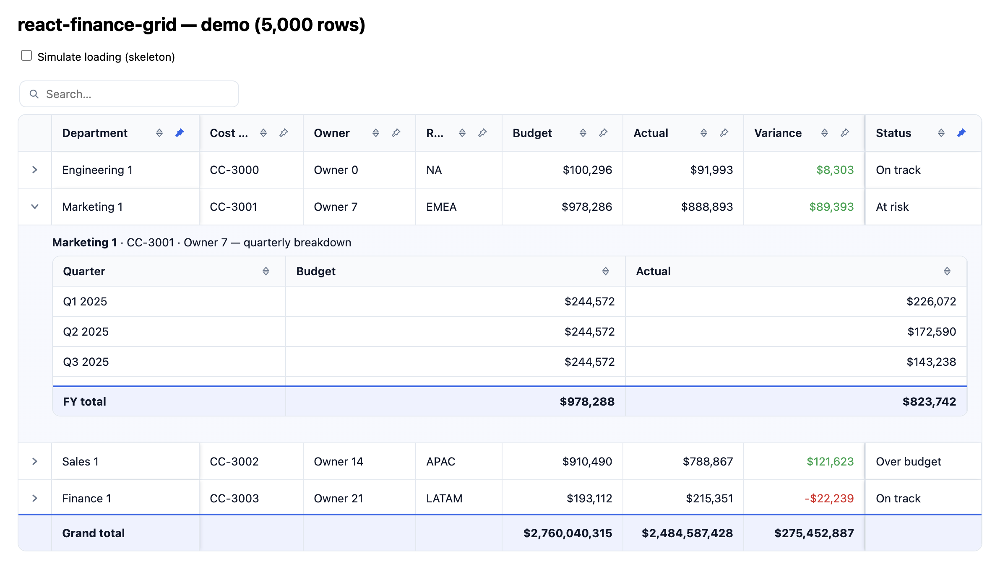

# react-finance-grid

High-performance, financial-grade data table for React 18+. TypeScript-first, **zero runtime dependencies**, SSR-safe, tree-shakeable, ESM + CJS + types.

> Working package name: `react-finance-grid`. The final npm scope/name can be changed in `package.json` before publish without any code changes.

## Demo



## Features

- 🦴 **Skeleton loading** — `isLoading` renders shimmer rows matching your real columns; standalone `<TableSkeleton />` works as a `<Suspense>` fallback.
- 📌 **Pin in place (left *and* right)** — pinning **never moves a column**; it sticks where the user put it. Header pin button + menu actions, controlled or uncontrolled pinning state, deterministic sticky offsets.
- ↕️ **Column drag reorder** — grip handle with HTML5 drag & drop, plus keyboard **←/→** and “Move left/right” menu actions; controlled or uncontrolled `columnOrder`, per-column `movable` opt-out.
- ☰ **Per-column menu** — sort asc/desc/clear (+ add-to-sort in multi-sort), pin left/right/unpin, move left/right, hide, reset width, highlight colours; fully keyboard navigable with Escape-to-close + focus restore.
- 🎨 **Column highlighting** — `none | blue | green | yellow | red | purple` applied to header, body and (optionally) total cells, themeable via CSS variables, controlled or uncontrolled.
- 👁️ **Column visibility** — hide from the menu or the toolbar *Columns* panel, `hideable` opt-out, order preserved while hidden, plus *Show all* / *Reset layout*.
- 💾 **Layout persistence** — `serializeLayout()` / `restoreLayout()` / `resetLayout()` via ref + `defaultLayout` / `onLayoutChange`; storage-agnostic.
- ↔️ **Horizontal scrolling** — the viewport scrolls; pinned columns stay put with correct layering and edge shadows.
- 🔽 **Expandable rows, sync *and* async** — many rows expanded at once, custom panel renderer, nested content (even a nested `DataTable`). Pass `loadRowDetails` and the grid manages per-row `idle → loading → success | error` state with built-in skeleton/error UI, retry, independent concurrent loads, and caching; controllable via `rowDetailStates`.
- 💰 **Grand total row** — sticky bottom; `sum` / `avg` / `min` / `max` / `count` / custom function per column; totals over **all** or **filtered** rows; custom finance formatters via `renderTotal`.
- 🪟 **Windowed rendering** — only visible rows (+ overscan) are mounted; binary-search virtualizer handles large datasets and mixed row/panel heights.
- ⇅ **Sorting (single + multi)** — header button cycles asc → desc → off; `multiSort` adds shift-click / menu chaining with sort-position badges; smart default comparator (number / Date / numeric-aware locale strings, nulls last); per-column `sortFn`; controlled or uncontrolled.
- 🔎 **Search** — optional built-in toolbar; searches configured columns; controlled or uncontrolled value.
- ↔ **Resizable + stretch columns** — drag handles (pointer) and keyboard (Arrow keys) resizing with `minWidth`/`maxWidth` clamping; `stretch` columns absorb leftover container width; stable with pinned columns.
- 🧱 **Density modes** — `compact | comfortable | spacious` row heights and padding; explicit `rowHeight` always wins.
- 💱 **Finance formatter helpers** — `formatCurrency` (including accounting negatives + compact), `createCurrencyFormatter`, `formatPercent`, `formatNumber`, `formatVariance`; numeric columns right-align by default.
- 🫙 **Distinct empty states** — `emptyMessage` (no data) vs `noResultsMessage` (search filtered everything out).
- ♿ **Accessible** — keyboard-reachable controls, `aria-sort`, `aria-expanded`, `aria-pressed`, labelled buttons, `role="table/row/cell"`, `aria-rowcount`/`aria-colcount`/`aria-rowindex`, visible focus rings, `prefers-reduced-motion` respected.

## Installation

```bash
npm install react-finance-grid
```

Peer dependencies: `react >= 18`, `react-dom >= 18`.

### CSS import

```ts
import "react-finance-grid/styles.css";
```

## Quick start

```tsx
import { DataTable, type ColumnDef } from "react-finance-grid";
import "react-finance-grid/styles.css";

interface DeptRow {
  id: string;
  department: string;
  budget: number;
  actual: number;
  variance: number;
}

const usd = (n: number) =>
  n.toLocaleString("en-US", {
    style: "currency",
    currency: "USD",
    maximumFractionDigits: 0,
  });

const columns: ColumnDef<DeptRow>[] = [
  { id: "department", header: "Department", accessorKey: "department", pin: "left" },
  {
    id: "budget",
    header: "Budget",
    accessorKey: "budget",
    aggregate: "sum",
    cell: (row) => usd(row.budget),
    renderTotal: (v) => (v === null ? "—" : usd(v)),
  },
  { id: "actual", header: "Actual", accessorKey: "actual", aggregate: "sum" },
  {
    id: "variance",
    header: "Variance",
    accessorFn: (r) => r.budget - r.actual,
    aggregate: (rows) => rows.reduce((s, r) => s + (r.budget - r.actual), 0),
  },
];

export function BudgetTable({
  rows,
  loading,
}: {
  rows: DeptRow[];
  loading: boolean;
}) {
  return (
    <DataTable<DeptRow>
      data={rows}
      columns={columns}
      getRowId={(r) => r.id}
      height={480}
      isLoading={loading}
      showSearch
      showGrandTotal
      grandTotalLabel="Total budget"
    />
  );
}
```

### Suspense fallback

```tsx
import { Suspense, lazy } from "react";
import { TableSkeleton } from "react-finance-grid";

const Dashboard = lazy(() => import("./Dashboard"));

<Suspense fallback={<TableSkeleton rows={10} columns={6} height={480} />}>
  <Dashboard />
</Suspense>;
```

## Advanced example — pin in place, reorder, menu, async details, persistence

```tsx
import { useCallback, useRef } from "react";
import {
  DataTable,
  parseLayout,
  serializeLayout,
  createCurrencyFormatter,
  type ColumnDef,
  type DataTableHandle,
  type GridLayoutState,
} from "react-finance-grid";

const usd = createCurrencyFormatter({ currency: "USD", locale: "en-US" });

interface DeptRow {
  id: string;
  department: string;
  owner: string;
  budget: number;
  variance: number;
  status: string;
}

interface Quarter {
  quarter: string;
  budget: number;
  actual: number;
}

const columns: ColumnDef<DeptRow>[] = [
  { id: "department", header: "Department", accessorKey: "department", pin: "left", hideable: false },
  { id: "owner", header: "Owner", accessorKey: "owner" },
  {
    id: "budget",
    header: "Budget",
    accessorKey: "budget",
    aggregate: "sum",
    cell: (r) => usd(r.budget),
    renderTotal: (v) => usd(v),
    highlight: "blue",
  },
  { id: "variance", header: "Variance", accessorKey: "variance", aggregate: "sum" },
  { id: "status", header: "Status", accessorKey: "status", pin: "right", movable: false },
];

function Dashboard({ rows }: { rows: DeptRow[] }) {
  const grid = useRef<DataTableHandle>(null);

  const onLayoutChange = useCallback((layout: GridLayoutState) => {
    sessionStorage.setItem("grid-layout", serializeLayout(layout));
  }, []);

  return (
    <>
      <button onClick={() => grid.current?.resetLayout()}>Reset layout</button>
      <DataTable<DeptRow, Quarter[]>
        ref={grid}
        data={rows}
        columns={columns}
        getRowId={(r) => r.id}
        density="compact"
        multiSort
        showSearch
        showColumnsPanel
        showGrandTotal
        defaultLayout={parseLayout(sessionStorage.getItem("grid-layout"))}
        onLayoutChange={onLayoutChange}
        loadRowDetails={(row) =>
          fetch(`/api/depts/${row.id}/quarters`).then((r) => {
            if (!r.ok) throw new Error(`HTTP ${r.status}`);
            return r.json() as Promise<Quarter[]>;
          })
        }
        expandedRowHeight={260}
        renderExpandedRow={({ row, detail, reload, collapse }) => (
          <div>
            <h4>{row.department} — quarterly actuals</h4>
            <ul>
              {detail.data?.map((q) => (
                <li key={q.quarter}>
                  {q.quarter}: {usd(q.actual)}
                </li>
              ))}
            </ul>
            <button onClick={reload}>Reload</button>
            <button onClick={collapse}>Close</button>
          </div>
        )}
      />
    </>
  );
}
```

## API reference

### `DataTableProps<T, D = unknown>`

| Prop | Type | Default | Description |
| --- | --- | --- | --- |
| `data` | `T[]` | — | Table rows |
| `columns` | `ColumnDef<T, D>[]` | — | Column definitions |
| `getRowId` | `(row: T, index: number) => string` | index-based fallback | Stable row id |
| `height` | `number \| string` | `480` | Scroll viewport height |
| `rowHeight` | `number` | density preset | Fixed row height (windowing contract) |
| `expandedRowHeight` | `number` | `220` | Declared expanded panel height |
| `density` | `"compact" \| "comfortable" \| "spacious"` | `"comfortable"` | Row height/padding preset |
| `overscan` | `number` | `6` | Extra rows rendered outside the viewport |
| `disableVirtualization` | `boolean` | `false` | Render all rows |
| `isLoading` | `boolean` | `false` | Show skeleton state |
| `showSearch` | `boolean` | `false` | Render built-in search toolbar |
| `searchValue` / `onSearchValueChange` / `defaultSearchValue` | `string` | uncontrolled | Search state |
| `sortState` / `onSortStateChange` / `defaultSortState` | `SortState \| null` | uncontrolled | Single sorting |
| `sorting` / `onSortingChange` / `defaultSorting` | `SortState[]` | uncontrolled | Multi sorting |
| `multiSort` | `boolean` | `false` | Enable shift-click / add-to-sort chaining |
| `columnPinning` / `onColumnPinningChange` / `defaultColumnPinning` | `ColumnPinningState` | from `column.pin` | Pinning membership state |
| `columnOrder` / `onColumnOrderChange` / `defaultColumnOrder` | `string[]` | column array order | Column order |
| `enableColumnReorder` | `boolean` | `true` | Header grip drag & drop |
| `columnWidths` / `onColumnWidthsChange` / `defaultColumnWidths` | `Record<string, number>` | uncontrolled | Explicit widths |
| `columnVisibility` / `onColumnVisibilityChange` / `defaultColumnVisibility` | `Record<string, boolean>` | from `column.hidden` | Visibility |
| `showColumnsPanel` | `boolean` | `false` | Toolbar *Columns* menu |
| `columnHighlights` / `onColumnHighlightsChange` / `defaultColumnHighlights` | `Record<string, HighlightColor>` | from `column.highlight` | Highlighting |
| `highlightTotals` | `boolean` | `true` | Apply highlight to total cells |
| `enableColumnMenu` | `boolean` | `true` | Per-column header menu |
| `expandedRowIds` / `onExpandedRowIdsChange` / `defaultExpandedRowIds` | `string[]` | uncontrolled | Expanded row state |
| `onRowExpand` | `(row: T) => void \| Promise<void>` | — | Fire-and-forget hook on expand |
| `loadRowDetails` | `(row: T, rowId: string) => Promise<D>` | — | Async detail loader |
| `renderExpandedRow` | `(ctx: ExpansionContext<T, D>) => ReactNode` | — | Custom expanded panel |
| `renderDetailLoading` | `(ctx: DetailLoadingContext<T>) => ReactNode` | built-in skeleton | Custom loading panel |
| `renderDetailError` | `(ctx: DetailErrorContext<T>) => ReactNode` | built-in error + retry | Custom error panel |
| `rowDetailStates` / `onRowDetailStatesChange` | `RowDetailStates<D>` | uncontrolled | Controlled async detail state |
| `onRowDetailReload` | `(row: T, rowId: string) => void` | — | Reload hook in controlled mode |
| `showGrandTotal` | `boolean` | `false` | Render sticky total row |
| `grandTotalLabel` | `ReactNode` | `"Total"` | Label for summary row |
| `totalsScope` | `"all" \| "filtered"` | `"filtered"` | Rows included in totals |
| `emptyMessage` | `ReactNode` | `"No results"` | Shown when `data` is empty |
| `noResultsMessage` | `ReactNode` | `"No matching rows"` | Shown when search filters all rows out |
| `toolbarStart` / `toolbarEnd` | `ReactNode` | — | Toolbar slots |
| `toolbarContent` | `ReactNode` | — | **Deprecated** — use `toolbarEnd` |
| `defaultLayout` | `GridLayoutState \| null` | — | Hydrate uncontrolled layout |
| `onLayoutChange` | `(layout: GridLayoutState) => void` | — | Fires on layout mutations |
| `className` | `string` | — | Root class name |

### `ColumnDef<T, D = unknown>`

| Field | Type | Default | Description |
| --- | --- | --- | --- |
| `id` | `string` | required | Unique column id |
| `header` | `ReactNode \| (ctx: HeaderContext<T>) => ReactNode` | `id` | Static or rendered header (`ctx` includes sort direction/index, pin side, highlight) |
| `accessorKey` | `keyof T` | — | Read a row field |
| `accessorFn` | `(row: T) => unknown` | — | Derived value accessor |
| `cell` | `(row: T) => ReactNode` | accessor value | Custom cell renderer |
| `footer` | `ReactNode \| ((ctx) => ReactNode)` | — | Footer content |
| `renderTotal` | `(value: unknown) => ReactNode` | raw aggregate | Custom summary renderer |
| `align` | `"left" \| "center" \| "right"` | numeric → `"right"` | Alignment |
| `width` | `number` | auto | Initial width |
| `minWidth` | `number` | `96` | Minimum width |
| `maxWidth` | `number` | — | Maximum width |
| `stretch` | `boolean` | `false` | Absorb leftover width |
| `sortable` | `boolean` | `true` | Allow sorting |
| `sortFn` | `(a, b) => number` | smart comparator | Custom comparator |
| `searchable` | `boolean` | `true` | Include in global search |
| `getSearchText` | `(row: T) => string` | accessor string | Search text extractor |
| `aggregate` | `"sum" \| "avg" \| "min" \| "max" \| "count" \| AggregateFn<T>` | — | Total-row aggregation |
| `pin` | `"left" \| "right" \| false` | `false` | Initial pin side |
| `pinnable` | `boolean` | `true` | Show pin controls |
| `movable` | `boolean` | `true` | Allow drag/keyboard reorder |
| `hidden` / `hideable` | `boolean` | `false` / `true` | Initial visibility / allow hiding |
| `highlight` / `highlightable` | `HighlightColor` / `boolean` | `"none"` / `true` | Initial highlight / allow highlighting |
| `menu` | `boolean` | `true` | Show per-column menu |
| `label` | `string` | header text or id | Accessible column label |
| `resizable` | `boolean` | `true` | Allow width changes |
| `className` | `string` | — | Cell class name |
| `meta` | `unknown` | — | Consumer metadata |

## Pinning model — “pin in place”

Pinning answers *“stick this column where it is during horizontal scroll”*, **not** *“move this column to the far left/right”*:

- A column’s position is owned exclusively by `columnOrder` (drag reorder / move actions). Pinning and unpinning never reorder anything.
- A **left-pinned** column sticks at the cumulative width of the *left-pinned columns that precede it in the order*.
- A **right-pinned** column mirrors that from the right edge.
- The last left-pinned column in order carries the right-edge shadow; the first right-pinned column carries the left-edge shadow.

| Situation | Behaviour |
| --- | --- |
| Pin column #3 while #1, #2 are unpinned | #3 stays at slot 3; when you scroll right it parks at the left edge and #1/#2 slide beneath it |
| Pin #1 and #3 (left) | They park at the edge in order; #2 scrolls under them |
| Reorder a pinned column | Pin state follows the column; sticky offsets recompute from the new order |
| Pinned columns separated by unpinned ones | Valid; the visual gap between them closes as you scroll |

Because pinned columns are not forced into a contiguous edge group, a pinned column only becomes “frozen” once the scroll position reaches it. If you want the classic frozen-pane look, drag pinned columns to the edge.

## Column reordering

- **Mouse**: drag the grip in the header onto another header cell.
- **Keyboard**: focus the grip and press **←** / **→**, or use the menu’s *Move left* / *Move right* actions.
- `movable: false` removes the grip, disables the move actions, and blocks the column from being used as a drop target.
- Moves operate on *visible* columns, skipping hidden and immovable ones, while the full order is preserved internally.
- Reordering composes with pinning, resizing, sorting, visibility and highlighting.

## Column menu

Enabled by default (`enableColumnMenu`, per column `menu: false`).

| Group | Actions |
| --- | --- |
| Sort | Sort ascending · Sort descending · Clear sort · Add ascending/descending to sort |
| Pin | Pin left · Pin right · Unpin |
| Layout | Move left · Move right · Reset width · Hide column |
| Highlight | Clear highlight · Blue · Green · Yellow · Red · Purple |

Keyboard behavior:
- **Enter/Space** opens.
- **↑ ↓ Home End** move focus.
- **Enter** invokes.
- **Escape** or **Tab** closes and restores focus to the trigger.

## Column highlighting

```tsx
{ id: "budget", header: "Budget", accessorKey: "budget", highlight: "blue" }

<DataTable
  columnHighlights={{ budget: "blue", variance: "red" }}
  onColumnHighlightsChange={setHighlights}
  highlightTotals={false}
/>
```

Variants: `none | blue | green | yellow | red | purple`.

```css
.rfg-root {
  --rfg-hl-blue-bg: #dbeafe;
  --rfg-hl-blue-strong: #3b82f6;
}
```

Highlight wins over row hover styling so emphasized columns stay readable.

## Async row expansion

```tsx
<DataTable<Row, Detail>
  loadRowDetails={async (row, rowId) => fetchDetail(rowId)}
  renderDetailLoading={({ rowId }) => <MySkeleton id={rowId} />}
  renderDetailError={({ error, reload }) => (
    <MyError error={error} onRetry={reload} />
  )}
  renderExpandedRow={({ detail, reload, collapse }) => (
    <Panel data={detail.data!} onReload={reload} onClose={collapse} />
  )}
/>
```

- Per-row state machine: `idle → loading → success | error`.
- Rows load independently and concurrently.
- Successful results are cached.
- `reload()` forces a refetch.
- Without `loadRowDetails`, expansion remains synchronous.
- Controlled mode is supported through `rowDetailStates`.

## Column visibility

```tsx
<DataTable
  showColumnsPanel
  columnVisibility={{ owner: false }}
  onColumnVisibilityChange={setVisibility}
/>
```

`column.hidden` seeds uncontrolled state, `column.hideable: false` prevents hiding, and the panel also offers *Show all columns* and *Reset layout*.

## Layout persistence

```tsx
const grid = useRef<DataTableHandle>(null);

<DataTable
  ref={grid}
  defaultLayout={parseLayout(savedJson)}
  onLayoutChange={save}
/>

const snapshot = grid.current!.serializeLayout();
grid.current!.restoreLayout(snapshot);
grid.current!.resetLayout();
```

A layout snapshot contains:
- `version`
- `columnOrder`
- `columnPinning`
- `columnWidths`
- `columnVisibility`
- `columnHighlights`
- `sorting`

## Imperative handle — `DataTableHandle`

| Method | Description |
| --- | --- |
| `serializeLayout()` | Returns the current `GridLayoutState` |
| `restoreLayout(state)` | Applies a snapshot object or JSON string |
| `resetLayout()` | Restores order, pinning, width, visibility, highlight and sorting defaults |

## Exported helpers

`serializeLayout`, `parseLayout`, `reconcileLayout`, `createEmptyLayout`, `formatCurrency`, `createCurrencyFormatter`, `formatPercent`, `formatNumber`, `formatVariance`, `cycleSingleSort`, `cycleMultiSort`, `addSort`, `removeSort`, `setSingleSort`, `makeSortComparator`, `LAYOUT_VERSION`.

## Exported types

`ColumnDef`, `DataTableProps`, `DataTableHandle`, `TableSkeletonProps`, `SortState`, `SortDirection`, `ColumnPinningState`, `ColumnOrderState`, `ColumnVisibilityState`, `ColumnWidthState`, `ColumnHighlightState`, `HighlightColor`, `Density`, `PinSide`, `Aggregate`, `AggregateFn`, `TotalsScope`, `Align`, `HeaderContext`, `ExpansionContext`, `AsyncDetailState`, `DetailStatus`, `RowDetailStates`, `DetailLoadingContext`, `DetailErrorContext`, `GridLayoutState`.

## Controlled vs. uncontrolled

Sorting, search, pinning, **column order, widths, visibility, highlights**, expansion, and **async detail states** all follow the same convention:

- **Uncontrolled**: omit the value prop and optionally pass `default*`; the grid owns the state.
- **Controlled**: pass the value prop (`sortState`/`sorting`, `searchValue`, `columnPinning`, `columnOrder`, `columnWidths`, `columnVisibility`, `columnHighlights`, `expandedRowIds`, `rowDetailStates`) and apply `on*Change` updates yourself.
- **Mixed** is fine: for example, control visibility from user preferences while leaving ordering and widths uncontrolled.

## Architecture notes

- **Div-based grid** (`role="table"`) instead of native `<table>`, because sticky pinned cells and absolute-positioned virtual rows are more reliable this way.
- **Windowing** uses fixed `rowHeight` and declared `expandedRowHeight` for predictable virtualization.
- **Pinning** preserves caller order and computes sticky offsets only from pinned predecessors or followers.
- **Layout state** is unified so order, pinning, widths, visibility and highlights can be serialized together.
- **Menus** render through `createPortal` into `document.body`.
- **Async details** use a per-row state machine with stale-response protection and success caching.
- **SSR** avoids browser globals at import time.

## Performance notes

- Only the visible window plus `overscan` rows is mounted.
- Keep `columns` and `data` referentially stable.
- `rowHeight` should match the visual row height.
- For very large datasets, prefer server-side filtering and sorting where needed.

## Accessibility notes

- `aria-sort`, `aria-expanded`, `aria-pressed`, labelled controls, focus rings, and keyboard interactions are supported.
- Resize handles are keyboard reachable.
- `aria-rowcount` and `aria-rowindex` describe the full dataset even when rows are virtualized.

## Known tradeoffs

- Fixed row and panel heights are still the default model.
- Pinned columns are not forced into one contiguous edge group.
- Drag reorder uses HTML5 drag and drop, so touch devices should prefer keyboard or menu movement.
- Menus are positioned on open and do not automatically reposition during scroll while open.
- Search is not internally debounced.
- Stretch redistribution stays single-pass when `maxWidth` is hit.
- `role="table"` is used instead of full `role="grid"` keyboard navigation.

## Roadmap

Shipped in 0.2.0:
- pin-in-place
- drag reorder
- column menu
- highlighting
- async row expansion
- visibility management
- layout persistence
- multi-sort
- density modes
- toolbar slots
- formatter helpers

Next candidates:
- `role="grid"` 2-D keyboard navigation
- row selection
- CSV/XLSX export helpers
- measured variable row heights
- column groups / multi-level headers
- server-driven data adapters
- touch-friendly drag reorder layer

## Local development

```bash
npm install
npm run lint
npm run typecheck
npm run test
npm run build
npm run validate:exports
npm run demo:build
```

## Publish steps

```bash
npm version patch|minor|major
npm publish --access public
```

## License

MIT