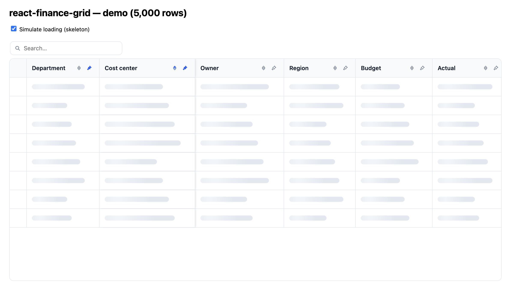
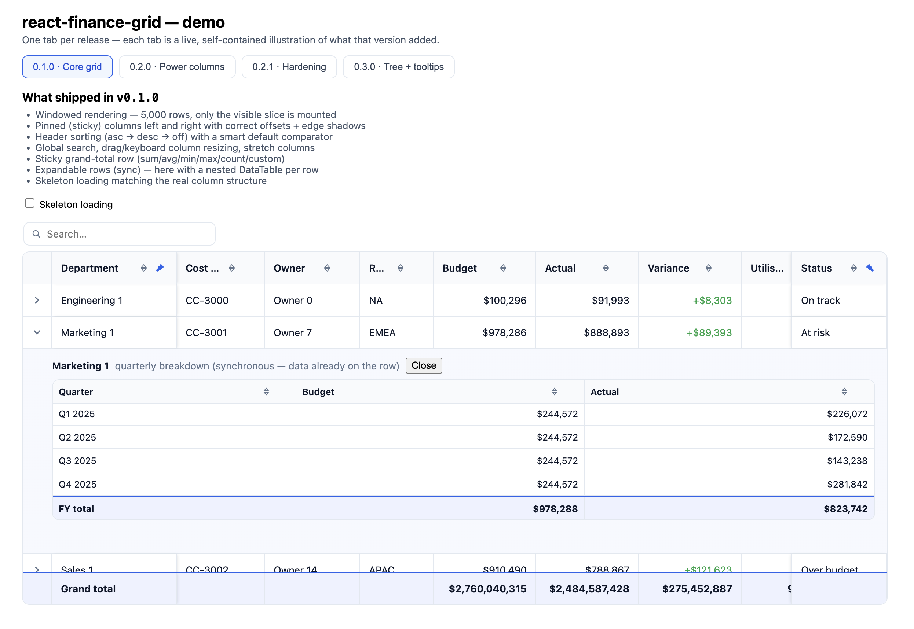
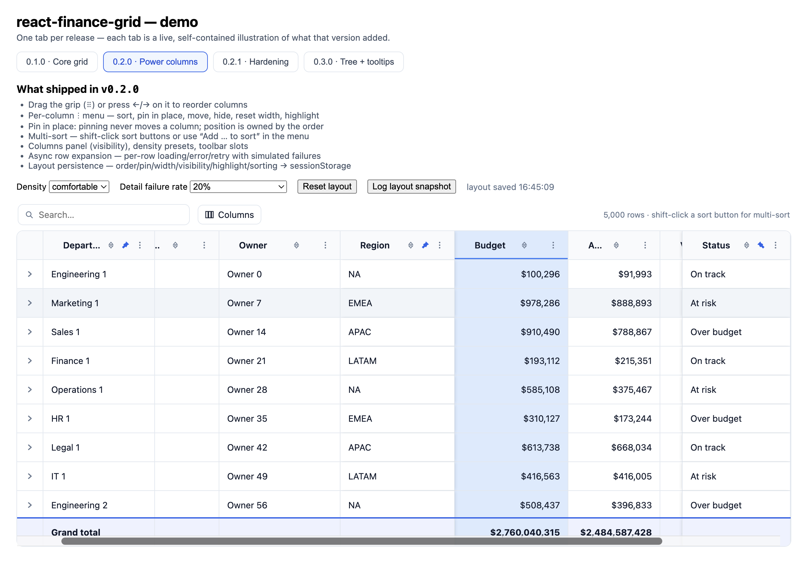
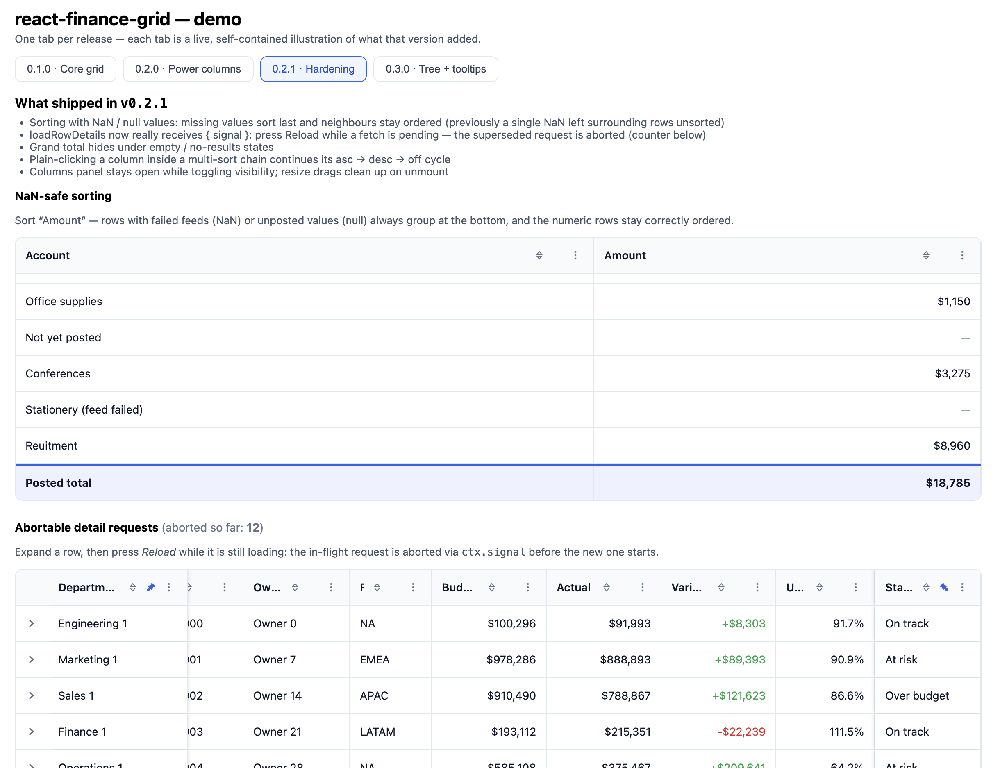
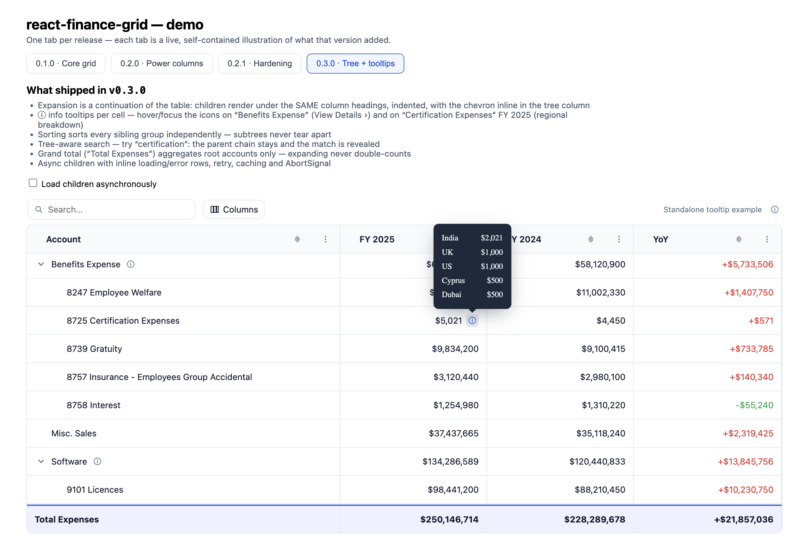

# Demo

Build and open:

```bash
npm run demo:build
npx serve demo        # or: python3 -m http.server -d demo 8080
# open http://localhost:8080/index.html
```

The demo is a **version-tabbed showcase** — one tab per release, each a live,
self-contained illustration of what that version added. It is covered by a
smoke test (`tests/demo-smoke.test.tsx`), so it can't silently rot.

## Tabs

### 0.1.0 · Core grid
5,000 finance rows (department / budget / actual / variance) with a
left-pinned Department column, a right-pinned Status column, header sorting,
global search, drag/keyboard column resizing, a sticky grand-total row,
**synchronous** expandable rows containing a nested per-quarter `DataTable`
with its own FY total, and a toggleable skeleton-loading state.
(Column menus/reorder are disabled on this tab to show the 0.1.0 surface.)

### 0.2.0 · Power columns
The same dataset with the full column system: drag/keyboard **reorder** (grip
⠿), the per-column **⋮ menu** (sort / pin-in-place / move / hide / reset width /
**highlight**), **multi-sort** (shift-click), the **Columns** visibility
panel, **density** presets, toolbar slots, **async row expansion** with a
configurable simulated failure rate (watch the per-row loading → error →
retry states), and **layout persistence** to `sessionStorage` (reorder
something, reload the page).

### 0.2.1 · Hardening
The bug-fix release, demonstrated live:

- **NaN-safe sorting** — a "messy numerics" grid with `NaN` and `null`
  amounts: missing values group at the bottom and the numeric rows stay
  correctly ordered (previously one `NaN` left neighbouring rows unsorted).
- **Abortable detail requests** — expand a row (slow 2.5 s fetch), press
  *Reload* mid-flight and watch the abort counter tick up: the grid now
  really passes `ctx.signal` to `loadRowDetails` and aborts superseded /
  unmounted requests.
- Plus: grand total hidden under empty/no-results states, multi-sort plain-click
  cycling, the columns panel staying open across toggles, resize-drag cleanup.

### 0.3.0 · Tree + tooltips
`TreeDataTable` with a hierarchical expense ledger (the reference design):

- Expand **Benefits Expense** — sub-accounts (8247, 8725, …) render as
  ordinary rows *under the same column headings*, indented, chevron inline.
- Hover/focus the **ⓘ** icons: "Benefits Expense" shows a *View Details ›*
  teaser (interactive content stays reachable); the FY 2025 cell of
  "Certification Expenses" shows a per-region breakdown (India, UK, US, …).
- Sort any column — sibling groups sort independently, subtrees stay intact.
- Search "certification" — the ancestor chain stays visible and the matching
  branch is revealed.
- "Total Expenses" aggregates **root accounts only** (expanding never
  double-counts).
- Flip **Load children asynchronously** to see inline loading rows, the
  error + retry row (set failure rate to 100%), caching on re-expand and
  `AbortSignal` wiring.

## Screenshots

### Skeleton Loading



### Demo



### 0.2.0 · Power columns


### 0.2.1 · Hardening


### 0.3.0 · Tree + tooltips

